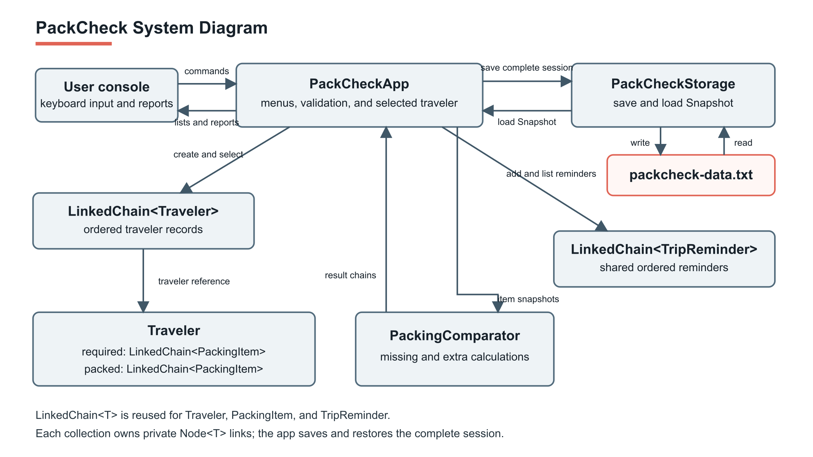

# PackCheck

PackCheck is a text-based packing checklist for multiple travelers. Each traveler has a required list and a packed list. Duplicate items represent quantities: if three socks are required and two are packed, one sock is missing. Trip reminders are shared by all travelers.

## System Diagram

## Reflection

### What changed from our specification?

- We added `TextRules`, which was not a separate class in the specification. The model constructors still validate their inputs, but `TextRules` holds the shared trimming, length, blank-text, and lowercase rules so they are not repeated in three classes.
- `PackingComparator` became a `final` class with a private constructor because it only has static methods. Its `missing` and `extra` methods use a copy of one list to count duplicate items without changing either original list.
- `PackCheckApp` accepts a `Scanner` and `PrintStream` in its constructor. This lets tests run complete menu sessions with scripted input and inspect the output. A private `EndOfInput` exception lets the app exit cleanly if input ends during an operation.
- The app shows positions starting at 1, while `Traveler` and `LinkedChain` use indexes starting at 0. The app converts between them.
- `Traveler.getItems` returns a copy to protect its lists. The app currently makes that copy when it needs a list’s size before insertion. We plan to add `Traveler.itemCount(PackingList)` to avoid that extra work.
- Tests use the course’s `student.TestCase` style. The generic-safety check is separate from the unit tests because its purpose is to confirm that invalid Java code does **not** compile.

### What changed in `LinkedChain`?

We extended the provided `LinkedChain<T>` rather than making separate list classes for travelers, items, and reminders. We added:

- `lastNode`, so `addToEnd` can append in constant time.
- `insert(int, T)` for adding an item at a chosen position.
- `removeAt(int)` for removing a specific occurrence by position.
- `copy()` so `Traveler` can return a safe list and `PackingComparator` can compare quantities without changing the originals.
- Private helpers for index checks, finding nodes, and unlinking nodes.

We also updated removal and clearing operations to keep `lastNode` correct when the last or only item is removed. The existing public operations remain available.

### What happened to our unknowns?

- **How to use one generic chain for several kinds of data:** Resolved. The program uses `LinkedChain<Traveler>`, `LinkedChain<PackingItem>`, and `LinkedChain<TripReminder>`.
- **How to count duplicate items without changing the lists:** Resolved. `PackingComparator` copies one list and cancels one matching item at a time.
- **How to test a console application:** Resolved. Tests pass scripted input and capture output through the app’s constructor.
- **How to check generic type safety:** Resolved. `GenericSafetyCheck.java` intentionally contains an incompatible type, and `run-tests.sh` checks that the compiler rejects it.
- **What file format to use for saving and loading, and how to handle damaged files:** Still open because save/load has not been built.

### What doesn’t work yet?

- The program does not save or load data, so a session is lost on exit.
- Travelers cannot be deleted or renamed.
- Items can be removed by position, but not by name. There is no command to clear a list.
- “Show items” does not group duplicate items into quantities, although comparison results do.
- The app does not ask for confirmation before exiting.
- Unassigned-item tracking is not built.

## Next Steps

### Finish the MVP, in order

1. **Vincy:** Add `Traveler.itemCount(PackingList)` and its tests so the app can get a list size without copying the list.
2. **Erik:** Add removal by item name and deletion of a traveler, including menu commands and error messages.
3. **Erik:** Show duplicate quantities in “Show items” and add exit confirmation.
4. **Erik:** Maintain `LinkedChain` and the test runner as new features are added.
5. **Vincy and Erik:** Run the full test suite, compare the final program with the specification, and update this README to match what is submitted.

### Stretch goals

- **We will attempt save/load.** Erik will lead the file format, loading validation, and tests. A failed load must leave the current session unchanged.
- **We are dropping unassigned-item tracking for this version.** We will reconsider it only after save/load is complete and tested.

### New tests needed

| Feature | Tests to add | Owner |
|---|---|---|
| `Traveler.itemCount` | Required and packed counts, empty list, null list argument | Vincy |
| Remove item by name | First matching occurrence, duplicate items, absent item, empty list, invalid input | Erik |
| Delete traveler | Delete selected traveler, delete last traveler, nonexistent traveler, empty collection | Erik |
| Item display and exit | Grouped quantities, empty display, valid and canceled exit confirmation, end of input | Erik |
| Save/load | Round trip, empty session, missing file, malformed data, overlength fields, failed load preserving current data | Erik |
| Regression | Rerun chain, model, comparator, app, and generic-safety checks after each change | Vincy and Erik |

## How to Run

This project uses Java 17 and can be run in Eclipse.

1. Open Eclipse and import the project using **File → Import → General → Existing Projects into Workspace**.
2. Select the PackCheck project folder and finish the import.
3. Open `src/PackCheckApp.java`.
4. Right-click the file and choose **Run As → Java Application**.

To run the tests, make sure the course `student.jar` is on the project’s build path. Then right-click a test class in `src` and choose **Run As → JUnit Test**.

## Attribution

The roles below are based on file authorship and repository history. The team should confirm any additional reviewing or testing before submission.

| File | Contributions |
|---|---|
| `LinkedChain.java` | CS 2114 staff provided the starter class. Erik added and revised chain operations. |
| `LinkedChainTest.java` | Erik wrote and committed tests. |
| `PackingItem.java` | Erik wrote and committed the model. |
| `PackingItemTest.java` | Vincy wrote and committed tests. |
| `PackingList.java` | Vincy wrote and committed the enum. |
| `TextRules.java` | Erik wrote and committed the shared validation helper. |
| `Traveler.java` | Erik made the initial commit. Vincy revised the model. |
| `TravelerTest.java` | Vincy wrote and committed tests. |
| `TripReminder.java` | Vincy wrote and committed the model. |
| `TripReminderTest.java` | Vincy wrote and committed tests. |
| `PackingComparator.java` | Erik made the initial implementation and now owns further revisions. |
| `PackingComparatorTest.java` | Erik wrote the initial tests and now owns additional tests. |
| `PackCheckApp.java` | Erik wrote and committed the console app. |
| `PackCheckAppTest.java` | Erik wrote and committed integration tests. |

**GenAI use:** OpenAI Codex helped write the specification and the prototype. Claude helped with the coding errors and testing.
